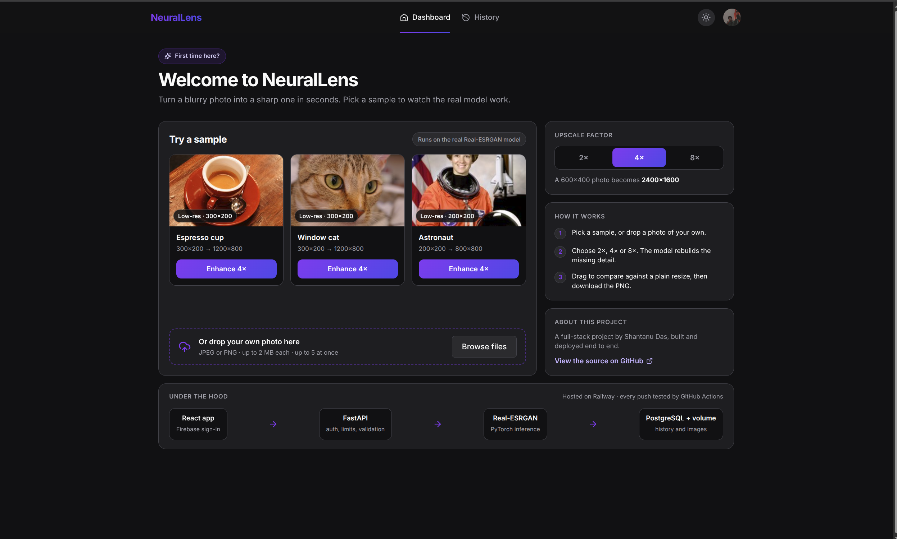
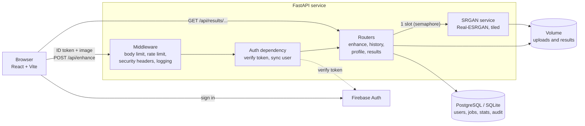
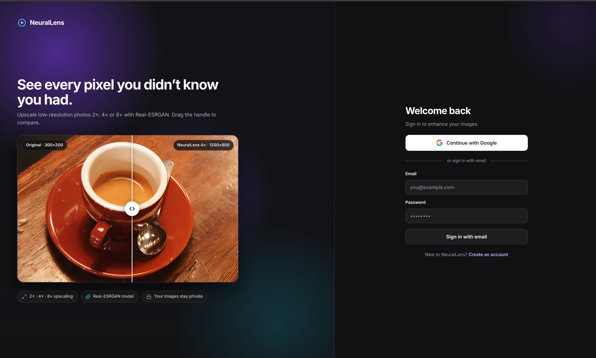
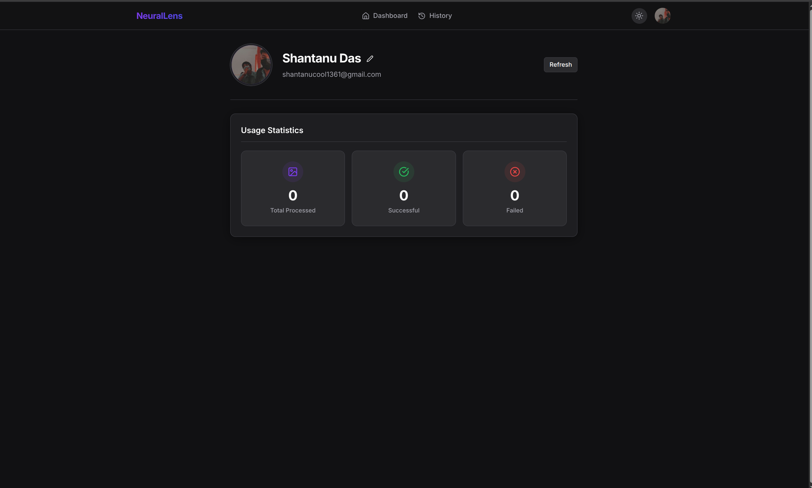

# NeuralLens

Full-stack AI image super-resolution: upload a low-resolution photo and get a 2x, 4x or 8x enhanced version, powered by Real-ESRGAN.


[](https://github.com/ShantanuDas15/NeuralLens/actions/workflows/ci.yml)


[](https://app.shantanudas.dev)

**Try it now: [app.shantanudas.dev](https://app.shantanudas.dev)**. Sign in with Google or email, then pick a built-in sample to run the real model without uploading anything.



## Overview

Bicubic and bilinear upscaling produce blurry results because they only interpolate existing pixels. GAN-based super-resolution models such as Real-ESRGAN reconstruct plausible fine detail instead. Running one safely behind a web API is the harder part: inference is memory-hungry, uploads are untrusted, and a single slow request can starve everyone else.

NeuralLens is an end-to-end implementation of that service. It has a React front end, a FastAPI back end with Firebase authentication, a bounded inference pipeline, persistent per-user history, and a Dockerised deployment with CI. It is built for people who want to upscale photos and for reviewers who want to see how an ML model is productionised.

## Key Features

- **2x, 4x and 8x upscaling** with Real-ESRGAN. The 2x and 4x paths use their own weights; 8x runs the 4x network with an 8x output scale.
- **Tiled inference** (default tile size 400 px), half precision on CUDA, and out-of-memory handling in the inference service.
- **Batch upload** (up to 5 files, JPEG or PNG, 2 MB each by default), a before/after comparison slider and PNG download.
- **Firebase authentication** (email/password and Google). The backend verifies ID tokens with the Firebase Admin SDK and mirrors users into its own database.
- **Per-user history and usage stats**, with soft deletes and an audit log.
- **Built-in samples** so a first-time visitor can try the real model without uploading anything.
- **Abuse and overload protection**: request body limit, input and output pixel limits, a per-IP rate limit (5/min on enhance, 120/min default), a single inference slot, a cap on queued jobs (503 with `Retry-After` when full), and security headers including a strict CSP.
- **Operational safeguards**: `/health` and `/ready` endpoints, fail-fast flags for production, structured JSON logging, and jobs marked failed on restart or shutdown.
- **CI** with backend tests, frontend lint and build, and dependency audits (`pip-audit`, `npm audit`).

## Tech Stack

| Area | Technologies |
|---|---|
| Backend | Python 3.11, FastAPI, Uvicorn, Pydantic / pydantic-settings, SQLAlchemy 2 (async), Alembic, SlowAPI (rate limiting), structlog |
| Frontend | React 19, Vite 8, React Router 7, Axios, Firebase JS SDK, JSZip, lucide-react |
| Database | PostgreSQL (Docker / production), SQLite via aiosqlite (local default), asyncpg |
| AI / ML | PyTorch (CPU wheels pinned), Real-ESRGAN (`realesrgan`, `basicsr`), OpenCV (headless), Pillow |
| Auth | Firebase Authentication, Firebase Admin SDK |
| DevOps | Docker (multi-stage, non-root), Docker Compose, Caddy (static front end), Railway, GitHub Actions |
| Tooling | pytest, pytest-asyncio, oxlint, pip-audit |

## Architecture

The browser signs in with Firebase and sends the resulting ID token with each API call. The FastAPI service verifies the token, validates the upload, and runs inference in a worker thread behind a single-slot semaphore. The request completes when the result has been written and the job row updated, so enhancement is synchronous per request, not a background queue.



Job lifecycle: `pending` -> `processing` -> `completed` or `failed`. Any failure after the job row is created marks the job failed and removes partial files. Database schema details are in [DATABASE_DESIGN.md](DATABASE_DESIGN.md).

## Project Structure

```
NeuralLens/
├── backend/
│   ├── main.py              # App factory, lifespan (DB, Firebase, model load), /health, /ready
│   ├── config.py            # Typed settings from environment variables
│   ├── routers/             # enhance, history, profile, results endpoints
│   ├── services/            # srgan.py (inference), image_utils.py (validation, PNG encoding)
│   ├── middleware/          # auth, rate limiting, body-size limit, security headers, logging
│   ├── models/ db/          # SQLAlchemy models and async session
│   ├── schemas/             # Pydantic request/response models
│   ├── alembic/             # Database migrations
│   ├── scripts/             # download_weights.py (checksum-verified weights)
│   ├── tests/               # pytest suite
│   ├── Dockerfile  start.sh railway.toml
│   └── requirements.txt  requirements-dev.txt  .env.example
├── frontend/
│   ├── src/
│   │   ├── pages/           # Dashboard, History, Profile, Login, Signup
│   │   ├── components/      # upload, compare slider, history, auth, layout, ui
│   │   ├── contexts/ hooks/ # Auth and theme state, API hooks
│   │   └── api.js firebase.js
│   ├── Dockerfile  Caddyfile railway.toml
│   └── .env.local.example
├── docs/screenshots/        # README images
├── docker-compose.yml       # Backend + PostgreSQL
├── DATABASE_DESIGN.md       # Schema documentation
└── .github/workflows/ci.yml # Tests, lint, build, audits
```

## Getting Started

### Prerequisites

- Python 3.11 and Node.js 22 (the versions CI uses)
- A [Firebase](https://console.firebase.google.com/) project with Email/Password and Google sign-in enabled
- A Firebase service account JSON key (Project settings -> Service accounts)
- Docker and Docker Compose (only for the Docker route)

The pinned PyTorch build is CPU-only, so no GPU is required. On a machine with CUDA, the service uses it automatically if a CUDA build of PyTorch is installed.

### Environment variables

Backend (`backend/.env`, copied from `backend/.env.example`):

| Variable | Default | Purpose |
|---|---|---|
| `FIREBASE_PROJECT_ID` | required | Firebase project ID |
| `FIREBASE_SERVICE_ACCOUNT_PATH` | `./firebase-service-account.json` | Path to the service account key file |
| `FIREBASE_SERVICE_ACCOUNT_JSON` | empty | Full key JSON as a string (for hosts without files); takes precedence |
| `DATABASE_URL` | `sqlite+aiosqlite:///./neurallens.db` | Database URL; `postgres://` URLs are normalised to asyncpg |
| `REQUIRE_POSTGRES` | `false` | Fail startup if `DATABASE_URL` is SQLite |
| `REQUIRE_MODEL` | `false` | Fail startup if weights are missing |
| `REQUIRE_FIREBASE` | `false` | Fail startup if the Admin SDK cannot initialise |
| `MAX_PENDING_JOBS` | `4` | Jobs admitted at once (1 running + waiting); extra requests get 503 |
| `UPLOAD_DIR` / `RESULTS_DIR` | `uploads` / `results` | File storage locations |
| `MAX_UPLOAD_BYTES` | `2097152` | Maximum upload size (2 MB) |
| `ALLOWED_ORIGINS` | `["http://localhost:5173"]` | CORS origins (JSON list) |
| `DEBUG` | `false` | Enables `/docs`, `/redoc`, `/openapi.json` and relaxes the CSP |

Further tunables exist in [backend/config.py](backend/config.py): `MAX_INPUT_PIXELS`, `MAX_OUTPUT_PIXELS`, `TILE_SIZE`, `QUEUE_TIMEOUT_SECONDS`, `DEFAULT_RATE_LIMIT`.

Frontend (`frontend/.env.local`, copied from `frontend/.env.local.example`): the six `VITE_FIREBASE_*` values from your Firebase web app config. `VITE_API_URL` is optional; when unset, the app calls `/api` on its own origin (the Vite dev server proxies this to `localhost:8000`).

<!-- TODO: add VITE_API_URL to frontend/.env.local.example so it is documented there too. -->

### Run locally

Backend:

```bash
cd backend
python3 -m venv venv
source venv/bin/activate
pip install --upgrade pip
# basicsr's build needs torch, numpy and Cython installed first
grep -E '^(--extra-index-url|torch==|torchvision==|numpy==|Cython==)' requirements.txt > /tmp/build-prereqs.txt
pip install -r /tmp/build-prereqs.txt
pip install --no-build-isolation -r requirements-dev.txt
python scripts/download_weights.py      # downloads Real-ESRGAN weights to backend/weights/
cp .env.example .env                    # then set FIREBASE_PROJECT_ID
# place your service account key at backend/firebase-service-account.json
alembic upgrade head
uvicorn main:app --reload --port 8000
```

Frontend (second terminal):

```bash
cd frontend
npm ci
cp .env.local.example .env.local        # then fill in your Firebase web config
npm run dev                             # http://localhost:5173
```

### Run with Docker

`docker-compose.yml` starts the backend and PostgreSQL. The compose file mounts `serviceAccountKey.json` from the repository root and reads `backend/.env`.

```bash
cp backend/.env.example backend/.env    # set FIREBASE_PROJECT_ID
# place your service account key at ./serviceAccountKey.json
export POSTGRES_PASSWORD='choose-a-password'
docker compose up --build
```

The API is then at `http://localhost:8000`. Model weights are downloaded and checksum-verified during the image build. The front end is not part of the compose file; run it with `npm run dev` as above, or build `frontend/Dockerfile`.

## Usage

All `/api` routes except `/health` and `/ready` require a Firebase ID token in the `Authorization: Bearer` header.

| Method | Path | Description |
|---|---|---|
| POST | `/api/enhance` | Multipart upload (`file`, optional `scale` of 2, 4 or 8, default 4). Returns the completed job. |
| GET | `/api/history` | Paginated job history (`page`, `page_size` up to 50) |
| DELETE | `/api/history/{job_id}` | Delete a job (204) |
| GET | `/api/profile` | Profile and usage statistics |
| GET | `/api/results/{filename}` | Download an enhanced image |
| GET | `/api/results/input/{job_id}` | Fetch the original input |
| GET | `/health`, `/ready` | Liveness and readiness (model, Firebase, database) |

Example:

```bash
curl -X POST http://localhost:8000/api/enhance \
  -H "Authorization: Bearer $FIREBASE_ID_TOKEN" \
  -F "file=@photo.jpg" \
  -F "scale=4"
```

Typical errors: `413` (file or pixel limits), `415` (not JPEG/PNG), `422` (invalid scale), `429` (rate limited), `503` (server busy, with `Retry-After`).

**API docs:** FastAPI's interactive docs are disabled by default to reduce exposed surface. Start the backend with `DEBUG=true` and open `http://localhost:8000/docs`.

## Testing

```bash
cd backend
source venv/bin/activate
python -m pytest -q
```

The suite (10 files, in `backend/tests/`) covers authentication, enhancement, history, profile, database models, the inference service, hardening limits, and deployment configuration. Frontend checks run in CI via `npm run lint` and `npm run build`; there are no frontend unit tests yet.

CI (`.github/workflows/ci.yml`) runs on pushes to `main`, pull requests, and weekly: backend tests, a `pip-audit` dependency audit, and frontend lint, build and `npm audit`.

## Screenshots

| Login | Profile |
|---|---|
|  |  |

## Design Decisions and Learnings

- **One inference slot.** Real-ESRGAN is memory-heavy, so a semaphore allows one inference at a time. Extra requests wait up to `QUEUE_TIMEOUT_SECONDS`, and admission is capped by `MAX_PENDING_JOBS` so load turns into a fast 503 instead of unbounded memory growth.
- **Validate before decoding.** A 2 MB file can decode to a very large image. Uploads are read with a hard cap, inspected from the header only, and checked against input and output pixel limits before any decode or inference.
- **Tiled inference.** Tiling bounds peak memory per image at the cost of some speed.
- **Firebase as the source of truth for identity.** The local `users` table is a projection created on verified requests, so the app never stores credentials.
- **Fail fast in production.** `REQUIRE_MODEL`, `REQUIRE_POSTGRES` and `REQUIRE_FIREBASE` turn silent misconfiguration (missing weights, ephemeral SQLite, broken auth) into a failed deploy.
- **Reproducible image.** Weights are fetched at build time with size and SHA-256 checks; the runtime image has no compilers and drops to an unprivileged user after fixing volume ownership.
- **Trade-off: synchronous processing.** Keeping enhancement inside the request keeps the architecture simple, but long jobs hold a connection open. See the roadmap.

## Roadmap

<!-- TODO: confirm or edit these; they are suggestions based on current gaps, not commitments. -->

- Background job queue with polling or WebSocket progress, instead of synchronous requests
- Frontend unit and end-to-end tests
- GPU-enabled image variant
- Benchmarks for latency and quality per scale and hardware
- Frontend service in `docker-compose.yml`

## Contributing

Issues and pull requests are welcome. Please run `python -m pytest -q` (backend) and `npm run lint && npm run build` (frontend) before opening a pull request.

## License

Released under the [MIT License](LICENSE).

The Real-ESRGAN model and weights are the work of their original authors ([xinntao/Real-ESRGAN](https://github.com/xinntao/Real-ESRGAN)) and are subject to their own license.

## Author

**Shantanu Das** (solo project)

- GitHub: [ShantanuDas15](https://github.com/ShantanuDas15)
- Email: shantanudev04@gmail.com
- LinkedIn: <!-- TODO: add LinkedIn URL -->
